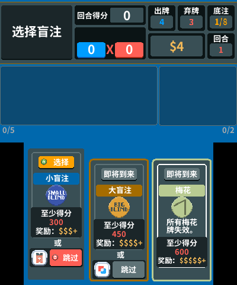
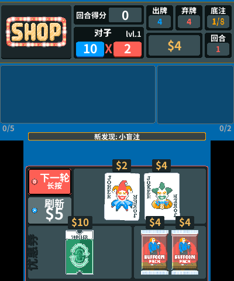

# Balatro3DS — 中文界面维护版

[English](README.md) | **简体中文**

这是 [idkhan/Balatro3DS](https://github.com/idkhan/Balatro3DS) 的简体中文维护分支，主要改善官方译名一致性、中文字库、3DS 小屏幕排版和按键提示。

长期维护分支为 **[`zh-cn`](https://github.com/the1ndex/Balatro3DS/tree/zh-cn)**。当前版本 **`v2.0.5-zh-fix1`**，基于上游 **`v2.0.5-base`**。[维护记录](MAINTENANCE.md) · [上游版本锁定信息](zh-upstream.json)

## 我们做了哪些优化

| 项目 | 本 fork 的修改 |
| --- | --- |
| 官方中文译名 | 修正原 2.0.3 中文翻译中与官方不同的 93 个目录名称。已检查的 327 个名称均与维护者本机 Steam 版的官方简体中文一致。 |
| 效果说明 | 补充版本标签“免费”、双倍标签不复制自身、古老小丑每回合改变花色等遗漏。灵质会显示下一次使用时的实际手牌上限惩罚。 |
| 中文字库 | 使用 Noto Sans SC Bold 的裁剪字库，派生字体名为 **Balatro3DS SC**，校正行高和基线。原生字库采用 13/17/21/27/33 像素五个高度，当前覆盖 967 个字符；相同高度的文字角色共用字体对象。 |
| 上屏信息区 | 回合得分、底注比例等读数限制在框内；Boss 说明和目标分数分区显示；“新发现”改为底部短提示，减少信息遮挡。 |
| 盲注选择 | 按中文说明的实际换行高度排版，避免标点落到行首，让分数、奖励和跳过按钮完整显示在下屏。 |
| 菜单与商店 | 菜单标签按宽度选择字号，改善牌组页面底部提示的可读性；增加显示保护，避免残留手牌盖住商店商品和按钮。 |
| 按键提示与手势 | 选择盲注显示当前确认键，跳过显示当前取消键；商店离开按钮显示取消键和“长按”。长按必须从商店内开始，在补充包里按 B 跳过后松手不会误离开商店；拖动、连选和改键也有对应保护。 |
| 本地化结构 | 保留稳定翻译键、卡牌内部 ID 和已有的结构化颜色片段，保留动态数值占位符，并加入官方译名、占位符、字库与界面回归检查。 |

这些修订建立在上游的渲染、本地化、结构化提示和输入系统上。2.0.5 的牌组效果重置、四指计分、补充包跳过触发和 Boss 行为等游戏规则修复来自上游，已合并到本分支。

## 界面预览

以下是本 fork 的桌面双屏预览，**不是 3DS 真机照片**。

| 盲注选择 | 商店与按键提示 |
| --- | --- |
|  |  |

## 版本与验证情况

已保留以下源码版本标签：

- [`v2.0.5-zh-fix1`](https://github.com/the1ndex/Balatro3DS/tree/v2.0.5-zh-fix1)：当前版本，上游基线 2.0.5。
- [`v2.0.4-zh-fix1`](https://github.com/the1ndex/Balatro3DS/tree/v2.0.4-zh-fix1)。
- [`v2.0.3-zh-fix2`](https://github.com/the1ndex/Balatro3DS/tree/v2.0.3-zh-fix2)。

2.0.5 维护版通过了 **242 项回归检查**、**327 个名称的官方中文对照**、翻译占位符和五个原生字库检查。桌面验证覆盖 84 种盲注布局、28 种 Boss 上屏信息和八个双屏界面。CIA 解包后的 648 个文件已核对，原生代码、进程设置、主页图标和横幅音乐与官方上游 2.0.5 包一致。

**这一维护版本已在日版 New 3DS 真机上测试，系统使用 Luma3DS 13.4。其他机型和地区版本尚未测试。** 上述结果覆盖列出的检查场景，不代表所有翻译、排版和游戏交互都已检查完毕。

## 安装与存档

本仓库目前提供本 fork 的**源码分支和版本标签**，尚未在 GitHub Releases 附加预编译汉化包。[上游 Releases](https://github.com/idkhan/Balatro3DS/releases) 提供的是上游版本。

如果持有从本分支构建的 CIA，可在有自制固件的 3DS 上使用 **FBI** 安装。Title ID 为 **`000400000BA1A700`**，与上游 2.x 相同，会更新同一个已安装标题。更换版本前请保留存档备份。存档目录保持为：

```text
SD:/3ds/save/Balatro3DS/sdmc/
```

从本分支构建的 `.3dsx` 放入 SD 卡的 `3ds` 目录后，可通过 Homebrew Launcher 启动。Mod 目录为 `/3ds/save/Balatro3DS/sdmc/mods`，支持的接口和限制见 [MODDING.md](MODDING.md)。

与本 fork 修改相关的默认操作：

| 界面 | 操作 |
| --- | --- |
| 盲注选择 | **A** 选择当前可用盲注；**B** 跳过允许跳过的盲注。 |
| 商店 | **X** 刷新；长按 **B** 至少 0.4 秒离开商店。 |
| 补充包 | **B** 跳过；随后松开按键仍停留在商店。 |

按键提示会跟随重新绑定的按键。触摸操作也可以与按键混用。

## 构建与后续维护

完整构建沿用上游流程：

```bash
./dev/setup.sh
./dev/build.sh        # CIA
./dev/build.sh 3dsx   # 3DSX
```

完整构建产物位于 `dev/dist/`。除上游构建依赖外，生成中文字库还需要 Python 和 `fonttools`。

本 fork 增加了以下维护检查：

```bash
python dev/test_zh.py
python dev/audit_zh_translation.py --official-game /path/to/Balatro.exe
python dev/verify_zh_font.py
```

这些检查需要 `lupa` 和 `fonttools`。译名对照从你自己安装的游戏中读取官方语言文件，不会下载该文件。`dev/` 下的发行包重打包脚本使用已锁定的官方 CIA 和维护者本机的 CTR 工具，并非独立完整的构建环境。具体流程见 [MAINTENANCE.md](MAINTENANCE.md)；较早的手动 3DSX 制作方式见 [BUILD.zh-CN.md](BUILD.zh-CN.md)。

后续以稳定上游发行版为基线合并更新，再检查翻译、字体、按键、受影响界面和安装包。旧版本标签会保留，方便比较与回退。目前尚未启用后台更新监控和自动发布。

## 致谢与许可证

- [idkhan/Balatro3DS](https://github.com/idkhan/Balatro3DS) 及贡献者：原 3DS 同人重制版和持续的游戏功能维护，包括 rosematcha 的贡献。
- Fussyzhy：上游简体中文翻译，本 fork 在其基础上校订。
- [LövePotion](https://github.com/lovebrew/lovepotion)、TurtleP 和 devkitPro：自制软件运行时与工具链。
- LocalThunk 和原版 Balatro 创作者：原游戏、美术与音频资源。请支持原版游戏。

这是非官方同人项目，与 LocalThunk 无隶属关系。项目代码许可证见 [LICENSE](LICENSE)，中文字库的 SIL Open Font License 1.1 见 [OFL-zh_CN.txt](resources/fonts/OFL-zh_CN.txt)。原游戏资源保留其原作者署名。
